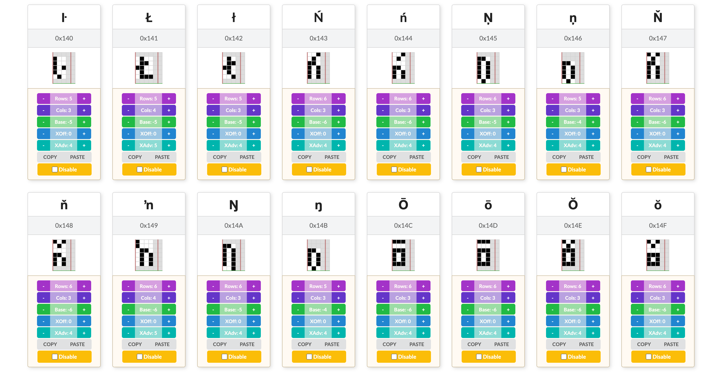
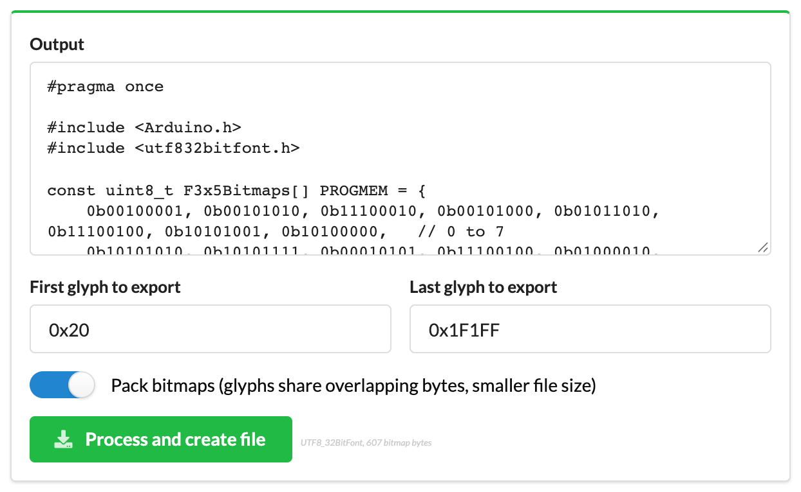

# Adafruit GFX Pixel font customiser

[](LICENSE)

A browser-based pixel editor for [Adafruit_GFX](https://github.com/adafruit/Adafruit-GFX-Library) bitmap fonts.
Paste the content of a `.h` font file, edit the glyphs pixel by pixel, and export an improved `.h` file.

This is a fork of [tchapi/Adafruit-GFX-Font-Customiser](https://github.com/tchapi/Adafruit-GFX-Font-Customiser)
that adds **segmented fonts with Unicode characters (UTF-8 extension)** and **bitmap packing** for smaller fonts.
It was created to draw the fonts of [bcp-clock](https://github.com/honzaskypala/bcp-clock), a tournament clock
for LED matrix displays.



## Features

- Edit each pixel of a glyph, its size, baseline, x offset and x advance (all values of the `GFXglyph` structure).
- Copy and paste glyphs, disable glyphs, add new characters, create a new font from scratch.
- Works well with the output of Adafruit's [fontconvert](https://github.com/adafruit/Adafruit-GFX-Library/tree/master/fontconvert),
  which does not always produce every glyph correctly (a missing pixel here and there). Best for small fonts (< 12 pt).

Added by this fork:

- **Full Unicode**: characters above 0xFF, including code points above 0xFFFF (e.g. emoji, regional indicators).
- **Segmented fonts**: a font is a set of segments, each a range of consecutive characters. Adding a character
  far away from the others starts a new segment instead of filling the gap with hundreds of empty glyphs.
- **Automatic output format**: a plain `GFXfont` when the characters form one range within 0x00–0xFF (works with
  stock Adafruit_GFX), otherwise a segmented `UTF8_32BitFont[]` (see [Font formats](#font-formats)).
- **Bitmap packing**: glyphs share overlapping bytes of the bitmap array and identical glyphs are stored once.
  The F3x5 font of bcp-clock shrinks from 1123 to 607 bitmap bytes.



## Usage

1. Open the editor (see [Running locally](#running-locally)).
2. Paste the content of a `.h` font file into *Extract font from source* and click **Extract**,
   or click **Create a new font**.
3. Edit the glyphs. Glyphs are grouped by segment.
4. Optionally set the range of characters to export and the **Pack bitmaps** toggle (on by default).
5. Click **Process and create file** and copy the result into your project.

Only one font per file is edited; other fonts in the same file are reported and left out of the export.

## Font formats

**Plain `GFXfont`** – the standard Adafruit_GFX format: one bitmap array, one glyph array and a `GFXfont` with
the first and last character. Adafruit_GFX prints single bytes, so only characters 0x00–0xFF can be used.

**Segmented `UTF8_32BitFont[]`** – an extension for UTF-8 text, used by bcp-clock:

```cpp
struct UTF8_32BitFont {
    GFXfont gfxFont;    // bitmap, glyphs of the segment, first, last, yAdvance
    uint32_t dFirst;    // first code point when above 0xFFFF (first = 0), else 0
    uint32_t dLast;     // last code point when above 0xFFFF (last = 0), else 0
};

const UTF8_32BitFont F3x5[] PROGMEM = {
    { (uint8_t *) F3x5Bitmaps, (GFXglyph *) &F3x5Glyphs[0], 32, 127, 6, 0, 0 },
    // ... one entry per segment ...
    { (uint8_t *) F3x5Bitmaps, (GFXglyph *) &F3x5Glyphs[484], 0, 0, 6, 127462, 127487 },
    {nullptr, nullptr, 0, 0, 0, 0, 0}   // terminator
};
```

All segments share one bitmap array and one glyph array. The text renderer decodes UTF-8 and looks up the
segment containing the code point; see bcp-clock's
[`lib/gfx`](https://github.com/honzaskypala/bcp-clock/tree/main/lib/gfx) for an implementation.

## Running locally

The editor is a static page without a build step (`index.html` + `gfxfont.js`, jQuery and Semantic UI from a CDN).
Clone or download the repository and open `index.html` in a web browser (double-click it); no web server is needed.

## Development

- `index.html` – user interface; glyph state lives in the DOM.
- `gfxfont.js` – font model, parser and generator, independent of the DOM (used by the page and by the tests).
- `test/*.h` – test fonts: fontconvert output and the bcp-clock fonts `f3x5.h` (segmented) and `f4x6.h` (plain).

Run the round trip test (parse → export → parse for every test font, with and without packing):

```sh
node test/roundtrip.js
```

## Contributors

 [Cyril Chapellier](https://github.com/tchapi) — original author

 [Chris Marrin](https://github.com/cmarrin) — added baseline, advance and offset support.

 [thelevelofdetail](https://github.com/thelevelofdetail) — fixes for negative xOffsets

 [Billy Donahue](https://github.com/BillyDonahue) — fixes for xadvance clipping when using _oblique_ fonts

 [Mats Engstrom](https://github.com/SmallRoomLabs) — fixes to allow generating a range of glyphs

 [Christof Arnosti](https://github.com/charno) — fixes to allow adding characters, improvements for disabled characters

 [Marcel Robitaille](https://github.com/MarcelRobitaille) — feature to allow the conservation of font preamble

 [Honza Skýpala](https://github.com/honzaskypala) — this fork: segmented fonts, UTF-8 extension, bitmap packing

 [Claude](https://claude.com/claude-code) (Anthropic) — implementation of the fork's parser, segmented export and bitmap packing

## License

MIT, see [LICENSE](LICENSE).
